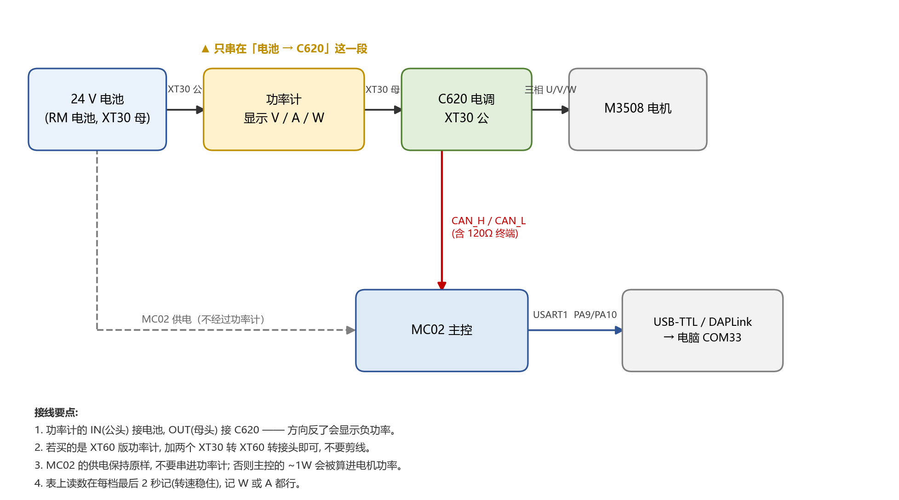

# 实验一：空载扫转速（MC02 + M3508/C620）

> 对应代码：`application/power_bench/`（`robot_def.h` 里 `APP_POWER_BENCH = 1` 时生效）
> 上位机：`tools/power_bench_log.py`（录数据）、`tools/power_bench_fit.py`（拟合 k1 / a）

---

## 一、为什么必须先做实验一

这套功率控制要拟合的模型只有一行：

```
Pin = CT·I·ω + k1·ω² + k2·I² + a
```

其中 `CT` 是已知常数，`k1 / k2 / a` 必须自己测出来。`k1`（与转速平方成正比的损耗：
铁损、风阻、齿轮搅油）和 `a`（静态损耗）**只能在空载下测**，因为空载时电流很小，
`k2·I²` 只有零点几瓦，可以先忽略，于是：

```
Pin − CT·I·ω = k1·ω² + a          ← 对 ω² 做一次线性回归就出来了
```

反过来，如果先做堵转实验（ω≈0，大电流），`ω²` 和 `I²` 会**共线**，最小二乘分不清
“这瓦是转速带来的还是电流带来的”，解出来的 `k1` 很可能是负的。所以顺序是**固定的**：

| 顺序 | 实验 | 让谁变 | 谁几乎不变 | 拟合 |
|---|---|---|---|---|
| ① | 空载扫转速 | ω | I 很小 | `k1`、`a` |
| ② | 堵转扫电流 | I | ω≈0 | `k2`（用①的 `a` 固定住） |

除此之外，先做实验一还有四个实际理由：

1. **它是唯一"错了也不会烧东西"的实验**：电流 ≤ 2500 counts、轮子悬空、没有堵转、
   没有大电流，最坏结果是数据难看。
2. **它顺带把整条链路验证一遍**：CAN 能不能发、C620 的 `0x201` 能不能收、
   1 kHz 控制帧有没有断、串口能不能稳定吐数据。这里面任何一条不对，实验二就是白做，
   甚至危险（电流指令发出去了、反馈没回来，你还以为电机没动）。
3. **它给出 `a`**：实验二拟合 `k2` 时 `a` 已知，`k2` 才不会被 `a` 带偏。
4. **它让你摸清电机的脾气**：启动死区多大、最高转速多少、发热多快、噪声多大 ——
   这些直接决定实验二的脉冲长度和安全电流。

一句话：**实验一是"校准仪器"，实验二是"称重"，顺序反了，称出来的数不可信。**

> 更详细的推导见 `motor_power_notes/拟合方法.md`；实验二的方案见
> `motor_power_notes/单电机验证方案.md`。

---

## 二、只有电调（C620）能不能做？

**能跑，但只能拿到实验一 5 个目的里的 1、2、4、5 —— 拿不到 `k1` 和 `a`。**

原因很简单：`k1`、`a` 是"输入功率减去机械功率"剩下的损耗，**必须有 `Pin`**。
C620 只回报力矩电流和转速，它自己也不知道吃了多少瓦。

所以本工程把实验一拆成两段，**今天就能做的是前半段**：

| 阶段 | 需要什么 | 能得到什么 |
|---|---|---|
| **1a 链路 + 脾气** | 只要 MC02 + C620 + 24V + 串口线 | CAN/反馈/时序是否正常、启动死区、转速-电流曲线、温升、最高转速 |
| **1b 拟合 k1、a** | 再加"每档一个母线电流读数" | `k1`、`a`（顺便粗估 `k2`） |

### 拿到电流读数的三种办法（按成本排序）

1. **万用表（最便宜）**：打到 **DC 10A 档**，串在 `24V+` 和 `C620 电源+` 之间。
   每一档电流稳定后读一次，记到 `manual.csv` 里。
   ⚠ 电流表内阻会让电压略降，所以**电压用板载 ADC 的读数**（CSV 的 `vbat_mv` 列），
   不要用万用表同时测电压（一个表测不了两个量）。
2. **带数显的直流电源**：直接看它的电流显示，连万用表都省了。
3. **INA226 / 功率计模块**：能自动记录，最省事。但 MC02 的 I2C（PB10/PB11）没有引到排针上，
   要么飞线，要么用带串口输出的功率计模块。
   —— 拿到之后把读数接到 `PowerBenchSetPinHook()`，CSV 的 `pin_mw` 列就有值了，
   拟合脚本会自动用它，**不用改任何分析流程**。

> 没有电流表也**建议先把 1a 跑掉**：它会告诉你"电流多少轮子才转""最高转速是多少"，
> 这两个数直接决定你实验二敢加多大电流、脉冲多长。

---

## 三、接线

```
24V+ ──[电流表(可选)]── C620 电源+
24V- ─────────────────── C620 电源-
C620 CAN_H ── MC02 CAN1_H (PD1)
C620 CAN_L ── MC02 CAN1_L (PD0)
两端各并一个 120 Ω（线短的话一端也行）

MC02 的 XT30 也接同一路 24V  ← 这样板载 ADC(PC4) 读到的就是母线电压

USB-TTL：MC02 PA9(USART1_TX) → TTL 的 RX
         MC02 PA10             ← TTL 的 TX（只收不发也能跑）
         GND ── GND（必须共地，TTL 的 VCC 不要接）
         波特率 115200-8N1
```

⚠ 轮子悬空，但**电机座要夹紧**：2500 counts 的扭矩足够让整台电机跳起来。
⚠ 上电顺序：先接好线 → 再给 24V → 最后插 USB（USB 只供电给 MC02 的话，CAN 收发器可能不工作）。

### 功率计接在哪（推荐方案，不用剪线）



| 要点 | 说明 |
|---|---|
| 位置 | **只串在「电池 → C620」这一段**，MC02 的供电保持原样不动 |
| 方向 | `IN`（公头）接电池，`OUT`（母头）接 C620；接反了显示**负功率** |
| 接头 | RM 电池和 C620 都是 XT30；若买的是 XT60 版功率计，加两个转接头，**不要剪线** |
| 读数 | 每档**最后 2 秒**记一次（转速已稳），记 `W` 最准，只有 `A` 也行 |
| 为什么不能串在 MC02 那一路 | 会把主控自己 ~1 W 的功耗算进电机功率，`a` 会偏大 |

> 做实验二（堵转测 `k2`）时，功率计的位置不变，只是把轮子夹住/顶住地面。

---

## 四、烧录

工程里已经装好 cmake-flash-kit，DAPLink 插上后：

```powershell
.\.flash\flash.ps1            # 编译 + 烧录（= VS Code 里 Ctrl+Shift+B）
.\.flash\flash.ps1 -NoBuild   # 只烧录
.\.flash\flash.ps1 -ListProbes # 看有没有认到 DAPLink
```

烧完打开串口（115200），正常应该看到：

```
[boot] 1/6 bsp init start
...
[bench] power bench ready: M3508(id=1) on CAN1, open-loop current, 16 segments
[bench] CSV: t_ms,Icmd,rpm,given,temp,vbat_mv,step,pin_mw  @50Hz on USART1 115200
[bench] press PA15 to start, press again to abort
[bench] boot chime OK (G-A-E5 heard => firmware is running)
[bench] idle, Icmd=0, vbat=24050mV | press PA15 to start
```

**听声音判断烧录是否成功**（不用接串口也能判断）：

| 听到什么 | 含义 |
|---|---|
| 一声短"滴"（60 ms） | `BSPInit()` 跑到了：5V、TIM12、蜂鸣器硬件正常 |
| 紧接着 **G-A-E5 三个上行音**（0.78 s） | 调度器起来了、`BuzzerInit()` 正常、`PowerBenchTask()` 在跑 —— **固件烧录成功** |
| 只有"滴"，没有三音 | 卡在调度器和 `PowerBenchTask()` 之间；现在串口会打 FAULT DUMP（见 [崩溃排查与中断规范.md](崩溃排查与中断规范.md)） |
| 什么都没有 | 没跑起来/没供电/固件没烧进去 |

开机音在 `application/power_bench/power_bench.c` 里的 `k_boot_chime[]`，想换就改那三行。

如果最后一行变成 `no feedback from C620`，先解决它，别往下走。

---

## 五、跑实验

### 1. 先录数据（另开一个窗口）

```powershell
python tools\power_bench_log.py -p COM7 -o noload.csv
```

（`COM7` 换成你的串口；脚本会把纯数字行写进 CSV，日志行打印在屏幕上。）

### 2. 按 PA15 开始

| 状态 | 彩灯 | 行为 |
|---|---|---|
| 待机 | 白 | 电流 0，等按键 |
| 准备 | 蓝 | 2 秒空转，让轮子停稳 |
| 运行 | 绿 | 逐档给电流，每档 **10 秒** |
| 结束/中止 | 红 | 电流归零，2 秒后回到待机 |

默认序列（`power_bench.c` 顶部的 `k_default_steps`）：

```
上升： 500 → 800 → 1100 → 1400 → 1700 → 2000 → 2250 → 2500 counts
下降： 2500 → 2250 → ... → 500 counts
每档保持 10 秒，全程约 2 分 45 秒
```

**任何时刻再按一次 PA15 = 立即把电流打到 0 并中止**（这是急停，不是暂停）。

### 3. 读电流

串口每换一档会打印：

```
[bench] step 3/16  Icmd=1100  hold=10000ms  (now is the time to read the meter)
```

看到这行之后再等 3~4 秒（转速稳定），读一次电流表，记下"第几档 + 多少安"。
**只需要电流一个数**，电压由板子自己记。

跑完写一个 `manual.csv`（段号就是日志里的 `step`，从 0 开始数）：

```csv
seg,I_A
0,0.42
1,0.66
2,0.90
3,1.15
4,1.39
5,1.63
6,1.84
7,2.05
8,2.04
9,1.83
10,1.62
11,1.38
12,1.14
13,0.89
14,0.65
15,0.41
```

> 上升段和下降段电流一样，但**摩擦不一样**（迟滞），所以两段都记。
> 只记上升段也能拟合，脚本会用能对上的段。

### 4. 先体检，再拟合

```powershell
# 只看数据长什么样（不需要电流表, 会打印启动死区/最高转速/温升）
python tools\power_bench_fit.py noload.csv

# 有电流读数: 直接拟合
python tools\power_bench_fit.py noload.csv --manual manual.csv
```

输出形如：

```
段   Icmd  given   rpm   vbat(V)  Pin(W)   temp  n
--------------------------------------------------------------
  0    500    498    820   24.05   10.10    31  500
  1    800    796   2140   24.03   15.86    31  500
...
=== k1 / a  (用 given, 14 个点) ===
  k1 = 1.18e-07  W/rpm²      (参考 1.23e-07, 偏差 -4%)
  a  = 4.35  W               (参考 4 左右, 合理范围 2~8)
  R² = 0.9821   RMSE = 0.31 W
  判定: 通过
```

### 5. 判据

| 项 | 通过 | 不通过怎么办 |
|---|---|---|
| `k1` | 0.5e-7 ~ 3e-7（M3508 参考 1.2e-7） | 负值 → 转速范围太窄 / 忘了减 `CT·I·ω` |
| `a` | 2 ~ 8 W | 负值 → 电流读数没校准 / 电压分压比不对 |
| R² | > 0.90 | 太低 → 数据里全是瞬态，把 `--steady` 调大（只取每档更靠后的部分） |
| RMSE | < 1 W | 偏大 → 母线电压在掉（电源限流）/ 温度漂了 |
| 复现性 | 换一组档位重跑，`k1` 变化 < 30% | 变化大 → 检查电流表量程/零点 |

把结果填回 `modules/power_control/power_control.c` 的默认值（或调用处传参）：

```c
if (s_cfg.model.k1 <= 0.0f) s_cfg.model.k1 = 1.23e-7f;   ← 换成你测的
if (s_cfg.model.a  <= 0.0f) s_cfg.model.a  = 4.081f;     ← 换成你测的
```

---

## 六、跑完一定要看的三件事

1. **`given` 跟 `Icmd` 差多少**
   低速段应该几乎相等。如果高速段 `given` 明显小于 `Icmd`，说明**反电动势顶住了**：
   电调已经满占空比，电流上不去。这是正常的物理现象，拟合时用 `given`（脚本默认就是它）。
   如果 `given` 几乎是 0 而轮子不转 → 电机堵转/相序/电调保护，停下来查。
2. **最高转速**
   如果 2500 counts 就到了 8000+ rpm，说明悬空负载太轻，下一轮把最高档降到 1800 左右，
   让 8 个点更均匀地铺在 `ω²` 上（两端各留一点余量，拟合更稳）。
3. **温升**
   连续跑 3 分钟，`temp` 涨超过 20°C 就要缩短单档时间或降低最高档。
   绕组温度会改变相电阻，`k2` 会漂 10% 左右。

---

## 七、常见问题

| 现象 | 原因 | 处理 |
|---|---|---|
| 串口没任何输出 | TX/RX 没交叉 / 波特率不是 115200 / 用了 5V 电平的 TTL | 换 3.3V 电平，确认 PA9 是 MC02 的 TX |
| 一直 `no feedback from C620` | CAN 没接 / 没共地 / 没 120Ω / 电调没供电 / ID 不是 1 | 先量 C620 电源，再查 CAN_H/L 是否反了 |
| 有反馈但轮子不转，`given` 也不涨 | 电流低于启动死区 | 把 `k_default_steps[0]` 从 500 提到 800 |
| 转速单调但 `given` 一直是 0 | C620 ID 与代码不一致（发到了 0x200 但 ID 槽位错） | 改 `power_bench.c` 里的 `tx_id` |
| CSV 只有表头 | 没按 PA15 / 按了但被中止 | 看彩灯颜色；红灯 = 保护中止，日志里有原因 |
| `Pin` 算出来是负的 | 电流表接反了 | 交换表笔，或把 `manual.csv` 里的电流写成负数（脚本会照用） |
| 拟合 `k1` 是负的 | 转速范围太窄 / 电流读数全是同一个值 | 加宽档位；确认每档真的读了不同的数 |

---

## 八、下一步

实验一通过后：

1. **改档位重跑一遍**（比如 700~2000，档距 200），确认 `k1` 稳定在 ±30% 以内；
2. 进实验二：**夹住轮子（或让轮子顶住地面）**，短脉冲扫电流，用实验一的 `a` 固定，
   拟合 `k2`；
3. 有了 `k1 / k2 / a`，`modules/power_control` 就可以在台架上跑闭环了
   （单电机只能验证"模型 + 反解 + 选根"，四轮分配要用软件仿真补，
   见 `motor_power_notes/单电机验证方案.md`）。

---

## 附：改参数的地方

| 想改什么 | 改哪里 |
|---|---|
| 电流档位 / 每档时长 | `application/power_bench/power_bench.c` 顶部 `k_default_steps[]` 和 `PowerBenchInit()` 里的 `hold_ms` |
| 要不要下降段 | `PowerBenchInit()` 里的 `s_cfg.down_pass` |
| 保护阈值 | `s_cfg.rpm_limit`（默认 9000 rpm）、`s_cfg.temp_limit`（默认 70°C） |
| CSV 频率 | `s_cfg.log_period_ms`（默认 20 ms = 50 Hz） |
| C620 的 ID / CAN 口 | `PowerBenchInit()` 里的 `tx_id` 和 `can_handle`（如 `BOARD_CAN2`） |
| 回到普通 demo | `application/robot_def.h` 里 `APP_POWER_BENCH` 改成 0 |
