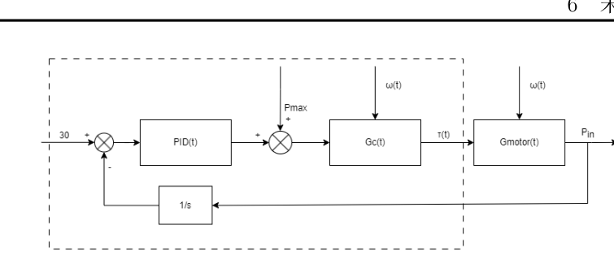
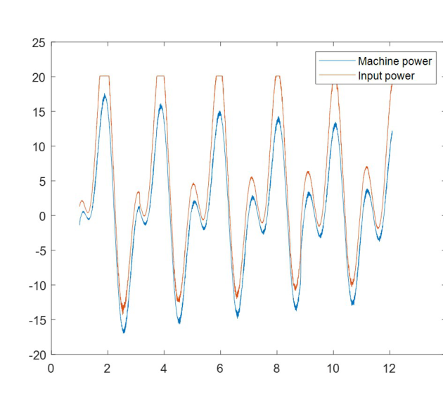
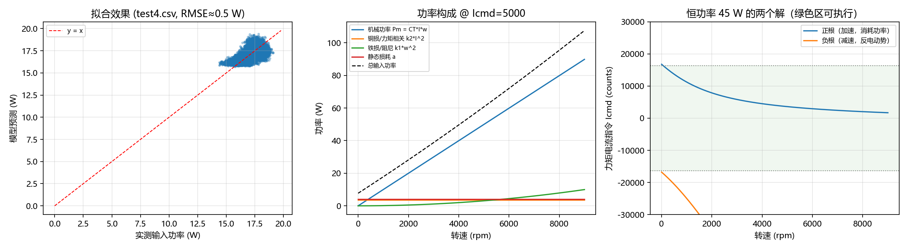
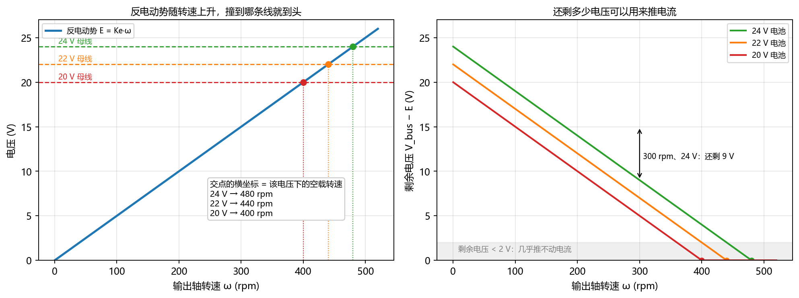
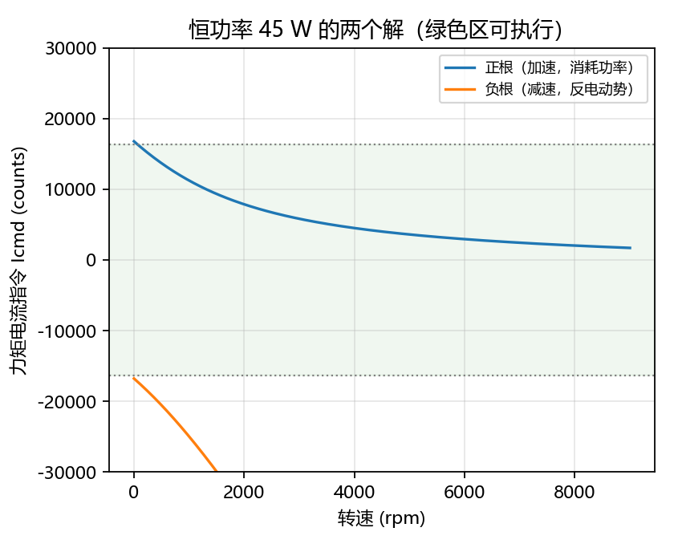
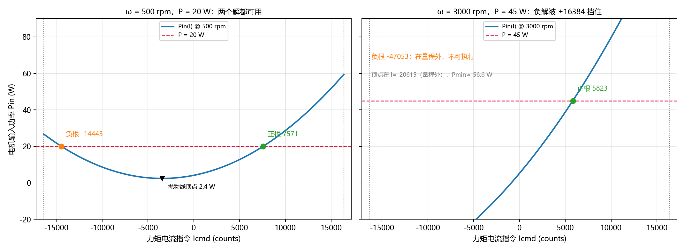

# RM 底盘功率控制：从这份开源工程入门

> 读者画像：会 C 语言、用过 STM32、知道 PID 是什么，但没做过功率控制、也没系统学过电机。
> 目标：读完你能（1）讲清楚这个模型每一项是什么、（2）自己拟合一版参数、（3）把它接到自己的车上。
>
> 工程：`Motor-modeling-and-power-control-master`（作者 林文浩 / GMaster）
> 配套文档：`开源报告.pdf`（中文，12 页，**必读**）、`ElectricVehiclePowerControl.pdf`（英文幻灯片）
> 作者视频：[算法讲解 BV1tu41177wm](https://www.bilibili.com/video/BV1tu41177wm/)、[恒功率启动演示 BV1mN411p7Nj](https://www.bilibili.com/video/BV1mN411p7Nj/)

---

**目录**：[0 这份工程在干嘛](#0-一句话说清这份工程在干嘛) · [1 工程地图](#1-工程地图) · [2 概念对齐](#2-先把概念对齐萌新-90卡在这里) · [3 功率模型](#3-功率模型四项分别是什么) · [4 反解两个根](#4-反解给定功率该发多大力矩本文最巧妙的地方) · [5 代码精读](#5-代码逐段精读114-行值得逐行看懂) · [6 三种策略](#6-三种功率控制策略为什么选第三种) · [7 自己拟合](#7-自己拟合一版参数可复现的完整流程) · [8 移植](#8-移植到你自己车上清单式) · [9 入门路线](#9-电控入门路线按这份工程倒推) · [10 FAQ](#10-踩坑清单faq) · [11 问题与改进](#11-我读出来的几个问题也是你的改进机会) · [12 七天计划](#12-建议的-7-天动手计划)

---

## 0. 一句话说清这份工程在干嘛

电机要出力，就得吃功率；裁判系统只给你 `Pmax` 的功率额度。问题是：**PID 算出来的是"力矩"，而限制是"功率"，两者之间差一个转速。**

这份工程做的事就是补上这个转换：

```
                    ┌─ 正向：已知 (转速, 力矩) → 算出这台电机此刻吃多少功率
功率模型 Pin(ω, τ) ─┤
                    └─ 反向：已知 (转速, 目标功率) → 解出该发多大力矩
```

有了反向解，就能让电机"吃固定功率"地跑——也就是**恒功率启动**：起步给大扭矩、高速自动收扭矩，全程贴着功率上限，加速最快且不超功率。

---

## 1. 工程地图

| 文件 | 作用 | 你要不要动 |
|---|---|---|
| `readme.md` | 项目说明、部署方式 | 读 |
| `开源报告.pdf` | **核心**：概念、推导、拟合、部署、踩坑 | 精读 2 遍 |
| `ElectricVehiclePowerControl.pdf` | 同一内容的英文幻灯片，图更直观 | 速览 |
| `chassis_power_control.c` | 部署代码（唯一一个 .c，114 行） | 移植时改 |
| `model_fit/power_model.m` | MATLAB 拟合脚本（49 行） | 换成自己的数据跑 |
| `model_fit/datasets/*.csv` | 12 组实测数据（正弦/斜坡/恒速 + 随机负载） | 拿来练手 |

依赖环境（readme 写明）：MDK-ARM V5、STM32F4、DJI 官方 `Development-Board-C-Examples/standard_robot`。
也就是说：**它不是一份能单独编译的工程**，而是"往官方标准机器人例程里替换一个文件"的补丁。这一点决定了你移植时要自己补齐接口（见第 8 节）。

### 数据流（把它记成一张图）

```
裁判系统 ──底盘功率/缓冲能量──┐
                              ├─► 缓冲能量 PID ─► 输入功率预算 ─► 电容 CAN 指令
电容电量 ─────────────────────┘                             │
                                                            ▼
速度环 PID 输出(4 个力矩电流) ──► 正向功率模型 ──► 总功率 ──► 缩放系数 k
                                                            │
                    每个电机: k×P ──► 反解二次方程 ──► 新力矩电流 ──► CAN 发给 C620
```

控制框图（报告图 7）：



外环是**缓冲能量环**（目标 30 J），内环是**功率→力矩的反模型** `Gc(t)`。功率预算 = `Pmax` 叠加缓冲能量 PID 的修正量（代码里是 `Pmax − pid.out`）。

---

## 2. 先把概念对齐（萌新 90% 卡在这里）

### 2.1 四个"电流"，别再混了

| 名字 | 谁产生 | 单位/范围 | 物理含义 |
|---|---|---|---|
| **give current** | 你算出来、发给电调的 | 整数 −16384~16384，无量纲 | 力矩电流**指令** |
| **given current** | C620 回传的 | 同上 | 电调**实际执行**的力矩电流指令 |
| **相电流** | 电机绕组里真实流动的 | A，峰值可到几十 A | 三相交流电流，产生力矩的那个 |
| **母线电流** | 电调从电池取的电 | A | 用 INA226 测，**算输入功率用的是它** |

关键结论（报告 2.2 节）：

- give/given current 不是安培，是"力矩电流指令值"，`Iτ = 20/16384 × Icmd` 才是安培。
- **力矩电流 ≠ 相电流**，更不能拿 `母线电压 × 力矩电流` 当输入功率。这就是为什么必须"建模"，而不是简单乘一下。
- 两者关系：`τ = KT × Iτ`，所以**发力矩指令本质上就是在设目标力矩**。

### 2.2 一条换算链（把这几个数背下来）

```
Icmd = 16384  ──►  Iτ = 20 A  ──►  τ = 0.3125 N·m (转子)  ──►  ω=5000 rpm 时  Pm = 163.6 W
```

- `KT = 0.3 × 187/3591 = 0.01562 N·m/A`
  手册上的 0.3 N·m/A 是**减速箱输出轴**的转矩常数；代码里反馈的是**转子**转速，所以要用减速比 3591/187 ≈ 19.2 折算到转子侧（0.3 / 19.2）。
- `9.55 = 60/(2π) = 9.5493`，把 rpm 换成 rad/s：`P = τω_rad/s = τ × (2πn/60) = τn/9.55`。
- `CT = (20/16384) × KT / 9.55 = 1.9969e-6`，代码里叫 `toque_coefficient`（拼写错了，是 torque）。它的量纲是 **W/(rpm·count)**，意思是"1 个 count 的力矩指令 × 1 rpm 转速 = 多少瓦"。

### 2.3 符号约定（作者强调了两遍，别跳过）

> 顺时针力矩为正、逆时针为负；顺时针转速为正、逆时针为负；功率为正=消耗，为负=输出。

为什么较真这个？因为模型里 `Pm = τ·ω` 是**带符号相乘**的：

- τ 与 ω 同号 → Pm > 0，电动状态，吃电；
- τ 与 ω 反号 → Pm < 0，发电状态，**电机在回馈、在帮电池充电**。

如果你全程取绝对值，就会把"回馈的 30 W"算成"消耗的 30 W"，白扔掉 30 W 的功率额度，还会误判超功率。报告的 4.1 节就是在批评广工方案用了绝对值——这是本工程的核心改进点之一。

---

## 3. 功率模型：四项分别是什么

### 3.1 主项：机械功率

```
Pm = τ · ω / 9.55        [W]，τ 单位 N·m，ω 单位 rpm
```

这是"真正用来推车"的那部分。但它只是总功率的**一部分**，高速高扭矩时占比下降。

报告图 1 的实测（同一台电机，正弦力矩 + 随机负载）：



蓝线是 `Pm`，橙线是实测输入功率。注意两点：
1. 两条线之间有 **2~3 W 的固定间隙**（损耗），低速时这个间隙占比极大。
2. 橙色在某些峰值处被削平了——那是 INA226 量程打满导致的采样失真，**不是电机真的这样**。这也是你自己采数据时要先检查的地方。

### 3.2 损耗项：经验公式

```
Pin = Pm + k1·ω² + k2·τ² + a
```

| 项 | 物理解释 | 典型量级（M3508+C620） |
|---|---|---|
| `k1·ω²` | 铁损（涡流∝ω²）+ 风阻 + 减速箱搅油，随转速平方增长 | k1 ≈ 1.2~2.5e-7 |
| `k2·τ²` | 铜损 `I²R`，相电流∝力矩，所以∝τ² | k2 ≈ 1.0~1.5e-7 |
| `a` | 电调静态功耗、驱动、采样电路 | 2~4 W |

**这是经验公式，不是从电机学推出来的。** 作者在报告里也直说了"查不到来源，但 RM 圈广泛使用"。它的价值在于：形式简单（只有两个二次项 + 常数）、参数少（3 个）、拟合残差小（好的数据能到 0.5 W 以内）。

从物理上讲它漏了一些东西：粘滞摩擦其实是 ∝ω 的一次项，磁滞损耗介于 ω¹~ω² 之间，温度会让 R 变化。这些都混进了 `k1`/`a` 里——这也是作者在"未来优化方向"里说的"探讨有无其他相关项"。**你如果以后想发论文/做更精细的控制，这就是切入点。**

### 3.3 部署时用的形式（用指令值，不用力矩）

为了省掉车上的乘法，作者把 τ 换成了 `Icmd`：

```
Pin = CT · Icmd · ω + k1·ω² + k2·Icmd² + a
```

推导（报告式 9）：

```
Pin = KT·Iτ·ω/9.55 + k1ω² + k2Icmd²
    = (KT/9.55)·(20/16384)·Icmd·ω + k1ω² + k2Icmd²
    = CT·Icmd·ω + k1ω² + k2Icmd²
```

所以**代码里那三个参数是对 `Icmd` 拟合出来的**，不是对 τ。你换电机（比如达妙、GM6020）时如果指令物理量变了，k2 的量纲和数值全变，必须重新拟合。

### 3.4 参数从哪来：作者给的 + 我重跑的结果

`power_model.m` 第 34 行硬编码了一组：`2.11e-7·ω² + 9.805e-8·I² + 2.138`——正好是 `test1.csv` 的拟合结果（我复现验证过，见下）。

我用 Python 把 12 组数据全部重拟合了一遍（脚本：`fit_power_model.py`）：

| 数据集 | k1 (ω²) | k2 (I²) | a | R² | RMSE/W |
|---|---|---|---|---|---|
| constantspeed | 2.176e-07 | **5.568e-06** | 0.000 | 0.969 | 0.39 |
| ramp | 4.725e-07 | 1.046e-06 | 0.700 | 0.919 | 0.06 |
| ramp2 | **−4.702e-07** | 1.708e-06 | 4.102 | 0.895 | 3.89 |
| sin | 3.442e-07 | 1.543e-07 | 1.036 | 0.553 | 1.17 |
| sin2 | −1.589e-07 | −4.762e-07 | 7.637 | 0.134 | 12.88 |
| sin3 | 3.080e-07 | 4.345e-07 | 0.693 | 0.824 | 0.47 |
| sin_0.25 | 1.373e-06 | 1.472e-07 | 1.059 | 0.860 | 0.50 |
| sin_4 | −3.407e-08 | −2.616e-07 | 5.474 | 0.018 | 16.17 |
| test1 | 2.110e-07 | 9.805e-08 | 2.138 | 0.671 | 0.28 |
| test2 | 2.046e-07 | 1.488e-07 | 2.156 | 0.955 | 0.31 |
| test3 | 2.519e-07 | 1.631e-07 | 1.217 | 0.939 | 0.34 |
| **test4** | **1.230e-07** | **1.453e-07** | **4.081** | **0.983** | 0.54 |

**这张表本身就值得你盯着看两分钟**，它教的东西比公式多：

- 同一个电机、同一套流程，换一组激励数据，k1 能从 **−4.7e-7 变到 +1.4e-6**（负的！物理上不可能）。原因不是电机变了，是**数据没激励出足够的信息**：
  - `constantspeed` 转速几乎恒定 → ω² 和 I² 高度共线 → 两个系数谁都能解释残差，拟合出 5.5e-6 这种荒谬值；
  - `sin2`/`sin_4` 的高速段太少 → R² 掉到 0.1~0.02；
  - 只有 `test4` 同时覆盖了较大范围的转速（0~5000 rpm）和力矩（855~9719），R²=0.983。但注意它的力矩**只有正向**（855~9719），所以"减速回馈"那半个象限其实没被验证过——这也是它最大的局限。
- 所以作者部署时用的是 test4 这组参数，而不是 report 里 test1 那组。**"换一组数据参数就变"是这类经验模型的天性**，不是 bug。



### 3.5 模型之外的第二条边界：电压受限

模型假设"电流环是完美的"——你要 20 A，电调就给 20 A。这在低速成立，高速不成立。

绕组上的电压关系是：

```
V_applied = E + I·R + L·dI/dt      E = Ke·ω   （反电动势）
```

- `E` 是反电动势，正比于转速；
- 电调能输出的电压上限就是母线电压 `V_bus`（还要扣掉调制余量和 MOS 压降）；
- 所以能灌进去的电流最多是 `I_max ≈ (V_bus − E)/R`。

转速越高 `E` 越大，`(V_bus − E)` 越小，能灌的电流越小；`E` 追上 `V_bus` 时电流归零——这就是"空载转速"。手册上 M3508 的 24 V / 482 rpm 就是这条线；电池掉到 22 V，空载转速跟着掉到约 442 rpm。



左图：蓝线是反电动势，三条虚线是不同电量下的母线电压；**交点就是该电压下的空载转速**（24 V→480、22 V→440、20 V→400 rpm）。右图：把"虚线减蓝线"画出来，就是还剩多少电压可以推电流——它到 0 的地方，就是速度上限。

注意量级：M3508 的相电阻只有几十 mΩ，20 A 时的电阻压降才 1~2 V，所以真正被电压"咬住"的只有最后几十 rpm（约 450 rpm 以上）；前半段一直是电调的 20 A 电流上限在管。对大电阻、高转速或超压使用的电机，这段会明显变宽。

对功率控制的影响：电压受限时**实际电流 < 指令电流**，模型按指令算出的功率会**偏大**（高估），表现为"明明没到功率上限，车却提不起速"。它不会导致超功率（方向是保守的），但会浪费性能。想补这个洞，就把电流上限也纳入限幅：

```
I_limit = min(16384, (V_bus − Ke·ω)/R 折算成 counts)
```

`Ke`、`R` 要实测或查手册。注意：反电动势**不是损耗**，它在模型里就是 `CT·I·ω = E·I` 那一项。

---

## 4. 反解：给定功率，该发多大力矩（本文最巧妙的地方）

把 `Pmax` 代进模型，整理成关于 τ 的一元二次方程（**k2 是 τ² 的系数，k1 是 ω² 的系数**）：

```
k2·τ² + (ω/9.55)·τ + (k1·ω² + a − Pmax) = 0
```

求根公式：

```
              −ω/9.55 ± √[ (ω/9.55)² − 4·k2·(k1·ω² + a − Pmax) ]
        τ = ──────────────────────────────────────────────────────
                                   2·k2
```

> ⚠️ 报告式 (6)(7) 和 `chassis_power_control.c` 把这两个系数的位置写反了（`k1` 乘到了 τ² 上、`k2` 乘到了 ω² 上）。数值本身没抄错，是"挂错了变量"。详见第 11 节 ①。下面按**正确形式**讲，代码里的写法你在对照时自己换一下。

### 为什么有两个根？两个都对！

这是作者踩过的坑，也是最漂亮的一个洞察：

> 在**同一时刻、同一转速**下，确实存在**一正一负两个力矩值**，都让电机恰好消耗 `Pmax`。
> 正根 = 加速（吃电做功）；负根 = 减速（反电动势，绝对值更大，因为要同时抵消回馈的能量）。

在 ω=5000 rpm、P=45 W 时的两个解（用 test4 的参数算的）：



（蓝线正根 ≈ 3600 counts；橙线负根在 0 rpm 就已经是 −16781，本身就在 ±16384 之外——**这个预算下它从头到尾都不可执行**。但"数学上存在"和"能不能发得出去"是两回事，见下一节。**同样的 45 W，减速时的力矩幅度理论上远大于加速**——这就是反电动势，也是"不能用绝对值"的原因。）

所以**不能**"先用正根，再按原力矩符号改符号"。作者原话：实际效果很差。正确做法是：

```c
if (原PID输出 > 0)  τ = 正根;
else               τ = 负根;
```

即**按原始力矩方向选根**，这样既不会反向，又能把减速时的负功率利用起来。

### 为什么要"按原始 PID 输出的方向"选根

两个根都能让这台电机"消耗 P 瓦"，但**车的行为完全相反**。功率控制器的职责只是"把力矩缩小到预算内"，不是"改变驾驶意图"。

例子：ω=500 rpm，速度环 PID 输出 +12000（想加速），原始功率约 37 W，预算 20 W，k=0.54。

- 选正根 **+7571**：还是加速，力矩从 0.228 N·m 降到 0.144 N·m，车继续加速、只是慢一点。✓
- 选负根 **−14443**：力矩变成 −0.276 N·m，**踩油门变成刹车**。✗

还有一个更硬的理由——**连续性**：k=1（完全不缩放）时，二次方程的根恰好等于原来的 PID 输出；k 从 1 慢慢减小，正根就从 +12000 连续滑向顶点。也就是说"选原来那支根"等于**沿着一条连续曲线把力矩收小**。换另一支，是瞬间跳变两万多 counts：电流冲击、齿轮冲击，下一周期 PID 看到转速骤降还会加大输出，两边打架。

### 手算一遍：ω = 500 rpm，P = 20 W

固定转速，`Pin` 就只是电流 `I` 的函数，是一条**开口向上的抛物线**：

```
Pin(I) = k2·I² + (CT·ω)·I + (k1·ω² + a)
       = 1.453e-7·I² + 9.984e-4·I + 4.112
```

注意中间那项 `(CT·ω)·I` **不是别的，就是机械功率** `Pm = τ·ω/9.55`，只是把 τ 换成了 I：

```
Pm = τ·ω/9.55 = (KT·Iτ)·ω/9.55 = [KT·(20/16384)/9.55]·I·ω = CT·I·ω
```

所以这条抛物线的三项分别对应：**机械功率（线性、可正可负）+ 铜损（二次、恒正）+ 固定损耗（常数）**。

要求 `Pin = 20 W`，移项：

```
1.453e-7·I² + 9.984e-4·I − 15.888 = 0

b² = 9.97e-7
4·k2·c = 4 × 1.453e-7 × (−15.888) = −9.23e-6
判别式 = 9.97e-7 − (−9.23e-6) = 1.02e-5      √ = 3.198e-3

I = (−9.984e-4 ± 3.198e-3) / (2 × 1.453e-7)
  → I₁ = +7571      I₂ = −14443
```

**两个解都代回去验算**（这就是判断"根对不对"的最快方法）：

| | I₁ = +7571 | I₂ = −14443 |
|---|---|---|
| 力矩电流 Iτ = 20/16384·I | +9.24 A | −17.63 A |
| 力矩 τ = KT·Iτ | +0.144 N·m | −0.276 N·m |
| 机械功率 Pm = τω/9.55 | **+7.56 W**（输出） | **−14.42 W**（回馈） |
| 铜损 k2·I² | 8.33 W | 30.31 W |
| 铁损 k1·ω² | 0.03 W | 0.03 W |
| 静态 a | 4.08 W | 4.08 W |
| **合计** | **20.00 W** | **20.00 W** |

同样的 20 W，两个工作点完全不同：

- **正根 = 电动**：机械功率 7.56 W 用来推车，剩下 12.4 W 变成热；
- **负根 = 制动**：机械功率 −14.42 W（电机在发电、往母线回灌），但绕组里烧掉 30.31 W，一进一出净消耗仍是 20 W。

所以"负根绝对值更大"不是数学巧合：**制动时要先抵消掉回馈的能量，才谈得上净消耗**。这正是反电动势。



从左图还能读出一件事：抛物线的**顶点在 I = −3436**（轻微制动），最小功率只有 **2.4 W**。也就是说这台电机在 500 rpm 下，最省电的工况不是"不通电"，而是"带一点点制动"——反电动势刚好把铜损抵消掉一部分。P 低于 2.4 W 时水平线碰不到抛物线，判别式 < 0，无解。

顶点为什么会在那里？对 `Pin(I)` 求导：

```
dPin/dI = 2·k2·I + CT·ω = 0   →   I* = −CT·ω/(2·k2)
```

含义很直白：**再加 1 count 电流，能多换到 `CT·ω` 瓦机械功率，同时多产生 `2·k2·I` 瓦铜损；两者相等时，总功率最小**。顶点在负电流处，说明"稍微发点电"比"完全不通电"更省——这就是反电动势在帮你抵损耗。

### ⚠️ 为什么不能"先取正根，再按原符号改"

还是会有人想：既然负根就是正根取反，那算正根再乘符号不就行了？**不行**，两个根不是相反数。

在 ω=500、目标 20 W 时，如果拿 `+7571` 再改成 `−7571`：

```
Pm = −7.56 W，铜损 = 8.33 W，铁损 0.03，静态 4.08
合计 = 4.88 W     ← 只有目标的 1/4
```

方向对了，幅度差了 4 倍。这就是作者说"按符号重新赋值，实际效果很差"的原因。

### 什么时候只有一个解、什么时候无解

| 转速 ω | P = 45 W 时的正根 | 负根 | 说明 |
|---|---|---|---|
| 0 rpm | +16781 | −16781 | 对称：正反转一样费电（此时 Pm=0，只剩 I²R） |
| 500 rpm | +13688 | −20559 | 负根已超量程 |
| 3000 rpm | +5823 | −47053 | 高速下想"制动着消耗 45 W"要 −47000 counts，做不到 |
| 6000 rpm | +2941 | −85400 | 高速只需很小的正力矩就吃满 45 W |

两个结论：

1. **转速越高，正根越小**——因为机械功率 `Pm = CT·I·ω = E·I`（反电动势 × 电流），转速高时每安培换到的机械功率更多，同样的功率只要更小的电流。注意低速段并不严格按 1/ω：500 rpm 时正根 13688，其中铜损就吃掉 27 W，只剩 13.7 W 变机械功；**低速时你其实是被电流上限卡住，而不是被功率上限卡住。**
2. **负根是不是"可用"，要看它有没有掉出 ±16384**。判据很简单：制动解可行 ⇔ 目标功率 ≤ 满制动电流时的净功率 `Pin(−16384)`。500 rpm 时 `Pin(−16384)=26.8 W`，所以 P=20 W 的负根 −14443 可用，P=45 W 的 −20559 不可用；3000 rpm 时 `Pin(−16384)=−54 W`（已经变成发电），任何正的 P 都没有可行负根。

所以在 45 W 这种预算下，"高速大力制动"根本不在可行域里；代码对负功率电机直接不缩放（`continue`）是合理的。负根真正会用到的是**低速轻制动**（比如 ω=500、P=20 这种），此时必须选对根。

> 注：上面用的是修正后的系数（ω²→1.230e-7、I²→1.453e-7）。用代码里挂反的那组算，根会差几十到几百 counts（例子里是 +8008 / −16126），结论不变。

### 两个边界要处理

1. **判别式 < 0**：目标功率低于这台电机在该转速下的"空载损耗"（`k1ω² + a`），物理上做不到"只吃这么点功率还转"。代码里 `continue` 直接保留了原力矩——**这是一个隐患**（见第 11 节）。
2. **超出 ±16384**：力矩电流指令限幅。低速时正根很容易超过 16384（图中蓝线左端），此时应该饱和到 16384，而不是继续按公式算。

---

## 5. 代码逐段精读（114 行，值得逐行看懂）

### 5.1 参数（第 25~28 行）

```c
fp32 toque_coefficient = 1.99688994e-6f; // CT
fp32 a    = 1.23e-07;   // 注释写 k1，实际乘在 Icmd² 上
fp32 k2   = 1.453e-07;  // 实际乘在 ω² 上
fp32 constant = 4.081f; // 就是公式里的 a
```

**变量名和注释跟实际用法对不上**，读代码时务必在纸上写一遍它实际算的是什么：

```
Pin = CT·Icmd·ω + 1.453e-7·ω² + 1.23e-7·Icmd² + 4.081
```

这和 test4 的拟合结果（ω²→1.230e-7，I²→1.453e-7）**正好对调**：两个数都没错，只是挂错了变量。详见第 11 节。

### 5.2 缓冲能量环 + 电容指令（第 30~35 行）

```c
get_chassis_power_and_buffer(&chassis_power, &chassis_power_buffer); // 裁判系统：实际功率、缓冲能量
PID_calc(&buffer_pid, chassis_power_buffer, 30);                     // 目标缓冲能量 30 J
get_chassis_max_power(&max_power_limit);                             // 当前功率上限
input_power = max_power_limit - buffer_pid.out;                      // 电池允许的输入功率
CAN_CMD_CAP(input_power);                                            // 告诉电容控制器
```

理解这段要看懂"缓冲能量"是什么：裁判系统给底盘一个 `Pmax`，但允许你短时间超一点，超出的部分从"缓冲能量"里扣，扣到 0 就强制降到 `Pmax`（甚至更低）。

`PID_calc(pid, ref, set)` 的误差是 `set − ref = 30 − buffer`，所以：

- 缓冲能量 **< 30**（用超了）→ 误差为正 → PID 输出为正 → `input_power = 上限 − 输出` **变小** → 收紧功率，把缓冲能量充回来；
- 缓冲能量 **> 30**（有存货）→ 误差为负 → PID 输出为负 → `input_power` **变大** → 放开用，把存货消耗掉。

**目标定 30 而不是 60（满）**，是留出余量给突发加速，同时避免"缓冲满了用不掉"。

> **缓冲能量 ≠ 超级电容**，两个东西经常被混为一谈：
>
> | | 缓冲能量 | 超级电容 |
> |---|---|---|
> | 本质 | 裁判系统的**虚拟额度**（记账） | 车上的**物理储能**（法拉电容组） |
> | 容量 | 0~60 J，规则定死 | 几百 J，看你并联了多少 |
> | 谁计量 | 裁判系统 | 你自己（电压/电流采样） |
> | 超额时 | 扣缓冲，扣到 0 就被强制限功率 | 放电补差额，裁判系统看不到 |
> | 恢复 | 少取电就自动回充 | 从电池充，或制动回馈充 |
>
> 一句话：**缓冲能量是裁判给你的"透支额度"，超级电容是你自己的"小电池"。** 这份工程用缓冲能量来**定预算**，用超级电容来**补差额**。
>
> 也正因为如此，老算法（只盯缓冲能量）在有电容的车上是失效的：电容把超额部分接走了，缓冲能量根本不掉，PID 以为一切正常，直到电容被抽干、整车瞬间掉功率。

> 上电第一件事：**验证这个方向**。用手推车/架空轮子制造大功率，看缓冲能量掉到 30 以下时预算是变大还是变小；反了就把 PID 增益或误差符号改回来。这个方向搞反 = 正反馈，会把缓冲能量打到 0 然后整车掉功率。

`CAN_CMD_CAP(input_power)` 是把"电池侧允许的输入功率"发给超级电容控制器：电容负责补差额，让电调看到的电压/功率稳定。**这一句是强耦合的**——它假定你的电容控制器认这个协议（标准机器人例程里是自定义 CAN 帧，不是通用协议）。

### 5.3 电容策略与按键（第 37~60 行）

```c
if (按 E) cap_state = 0;   // 经济模式
if (按 Q) cap_state = 1;   // 爆发模式

if (cap_percent > 5) {
    cap_state==0 ? chassis_max_power = input_power + 5     // 只比预算多 5 W
                 : chassis_max_power = input_power + 200;  // 主动放电，多要 200 W
} else {
    chassis_max_power = input_power;                       // 电容没电，别指望它
}
```

`+5 W` 这个细节很妙：如果一直让电容满电，电容就"没地方充电"，能量利用率反而低。让底盘常态多取 5 W，电容缓慢放电、留出充电空间；需要爆发时按 Q 主动放 200 W。

电容电量 < 5% 时退回纯电池功率——**保护逻辑必须有**，否则电容空了整车瞬间掉功率。

### 5.4 正向算功率（第 62~71 行）

```c
for (i = 0; i < 4; i++) {
    initial_give_power[i] = out·CT·speed + k2·speed² + a·out² + constant;
    if (initial_give_power[i] < 0) continue;   // 负功率（回馈）不计入总和
    initial_total_power += initial_give_power[i];
}
```

负功率电机被跳过：它不但不占额度，还在**发**电。这是本方案相对"绝对值缩放"的关键优势。

### 5.5 缩放 + 反解（第 73~113 行）

```c
if (initial_total_power > chassis_max_power) {
    power_scale = chassis_max_power / initial_total_power;   // k < 1

    for (i = 0; i < 4; i++) {
        scaled_give_power[i] = initial_give_power[i] * power_scale;

        b = CT * speed;
        c = k2*speed² − scaled + constant;
        inside = b*b − 4*a*c;            // 判别式
        if (inside < 0) continue;        // ← 隐患：保留原力矩

        if (out > 0) out = (−b + √inside) / (2a);   // 选正根
        else         out = (−b − √inside) / (2a);   // 选负根

        out = clamp(out, −16000, +16000);           // 注意是 16000 不是 16384
    }
}
```

两个小细节：
- 上面是按**代码原样**写的（`a` 是 I² 系数、`k2` 是 ω² 系数）。修正系数位置后应该是：`c = 1.230e-7*speed² + constant − scaled; disc = b*b − 4*1.453e-7*c;`，除数也用 `2*1.453e-7`。
- 限幅用的是 **16000**，比 16384 留了 384 的余量（防止饱和后 PID 继续积分、也避开协议边界）。
- **负功率电机也会被"缩放"**：`scaled_give_power[i]` 仍是负数，`if (scaled_give_power[i] < 0) continue;` 让它保持原样——即"发电的电机不限制"。作者在报告里说这是有意的：让其他电机去"吸收"这部分负功率。

---

## 6. 三种功率控制策略，为什么选第三种

| 方案 | 做法 | 问题 |
|---|---|---|
| ① 均分 | `Pmax/4` 分给每个电机 | 四轮负载/转速不同，均分必然有的轮吃不饱、有的轮吃不完；加速时左右轮功率相同但负载不同 → **走不直** |
| ② 绝对值缩放（广工） | 全部取绝对值，解一个总缩放系数 k | 丢掉了负功率信息：减速回馈被当成消耗 → **理论功率与实际严重偏差**，白白浪费额度 |
| ③ 功率再分配（本工程） | 正向算各自功率 → 求 k → 按原力矩方向选根 → 反解新力矩 | 需要可靠的模型参数；计算量稍大（4 次开方） |

方案 ③ 的本质：**不是缩力矩，而是缩功率**。因为 `P ∝ τ²`（损耗项）和 `P ∝ τω`（机械项）不是线性的，直接缩 τ 会导致功率缩得不对；先缩 P 再反解 τ 才是精确的。

顺带解释了"为什么能多榨出一点"：负功率电机不缩放，等于让它们继续回馈，把额度让给驱动轮。

---

## 7. 自己拟合一版参数（可复现的完整流程）

> 你几乎一定要重做这一步：作者明确说了 **k1 随减速箱个体差异变化**，不同车、不同保养状态都不同。

### 7.1 硬件

- INA226（或 INA226 模块）串在**电调电源正极**，采样电阻按最大母线电流选（M3508 起步/堵转时能到十几安，留够余量，别像报告图 1 那样被打满）；
- 母线电压分压进 INA226 的 VBUS；
- I2C 接到主控，1 kHz 左右读取；
- 电机**必须带负载**（报告 5.1 节第 1 条：空载时"力矩电流指令 ≠ 力矩电流"，拟合会完全错）。

### 7.2 激励设计（这步决定成败）

作者用的是"**不同频率幅值的正弦力矩指令 + 随机负载**"。你要保证：

1. **转速覆盖**：从 0 到接近最高转速（M3508 转子约 9000 rpm），每个区间都有数据；
2. **力矩覆盖**：从 0 到 ±16384，正负都要（负力矩才能拟合出回馈行为）；
3. **两者不要同步变化**：如果"转速高时力矩一定小"，ω² 和 I² 就共线，参数无法区分（看第 3.4 节那张表就懂了）；
4. 每个工况持续几秒，让温度稳定；
5. 记录母线电压（电池从 25.2 V 掉到 22 V 会明显改变功率）。

### 7.3 采集

STM32CubeMonitor（或你自己的上位机）按 500 Hz 导出 CSV，表头是：

```
timestamp_current;current;
timestamp_give_current;give_current;
timestamp_motor_chassis[0].given_current;motor_chassis[0].given_current;
timestamp_motor_chassis[0].speed_rpm;motor_chassis[0].speed_rpm
```

⚠️ 每个通道有**自己的时间戳**，行与行之间有几毫秒错位。作者的做法是直接按行对齐（工程里的数据就是这么来的），残差 0.5 W 说明够用；如果你要更准，按时间戳插值对齐。

### 7.4 拟合

MATLAB（作者的 `power_model.m`）：

```matlab
Pother = bus_voltage*current - (speed_rpm .* give_toque)/9.55;
g = fittype('k1*speed_rpm^2 + k2*give_current^2 + c', ...
            'independent',{'speed_rpm','give_current'}, 'dependent','Pother');
myfit = fit([speed_rpm, give_current], Pother, g);
```

没有 MATLAB 就用我写的 `fit_power_model.py`（numpy + matplotlib，跑一遍出表 + 三张图）：

```powershell
python fit_power_model.py            # 拟合全部 12 组数据并出图
python fit_power_model.py --no-plot  # 只看数字
```

**路线 B：两步法**（不需要 MATLAB，物理意义最清楚，适合没条件采"正弦+随机负载"的人）

1. **轻载扫转速**：电流很小时 `CT·I·ω` 和 `k2·I²` 都可忽略，`Pin ≈ k1·ω² + a`。对 `ω²` 做一次线性回归，斜率就是 `k1`，截距是 `a`。
2. **堵转扫电流**：`ω ≈ 0` 时机械功率为 0，`Pin ≈ k2·I² + a`。对 `I²` 回归，斜率就是 `k2`（`a` 用第 1 步的值或一起拟合）。

两条注意事项：堵转必须**短脉冲**（几秒一次，中间冷却），否则绕组升温 `R` 变大、参数漂；每组数据都要记母线电压，电压不同不能混在一起拟合。

**量级校验**（拟合结果离谱时用）：铜损 `P_cu = 1.5·Iτ²·R`（把 `Iτ` 当 q 轴峰值电流），代入 `Iτ = 20/16384·Icmd`：

```
k2 = 1.5 · R · (20/16384)² ≈ 2.2e-6 · R      [W/count²]，R 单位 Ω
```

拟合出来的 `k2=1.453e-7` 反推 `R ≈ 0.065 Ω`——拿手册的相电阻对一下，同量级就说明数据没大问题。`k1`（铁损+风阻+齿轮搅油）没有简单公式，只能实测。

### 7.5 验收标准

1. **残差**：RMSE < 1 W、无系统偏差（残差均值 ≈ 0）；
2. **交叉验证**：用 A 组拟合、B 组验证，RMSE 不能爆掉（爆掉 = 过拟合/激励不足）；
3. **装车验证**：把模型预测的功率和裁判系统实测功率对比，误差应 < 5%；
4. **边界检查**：ω→0、ω→9000、I→±16384 时预测值是否单调、是否物理合理。

### 7.6 常见坑

| 现象 | 原因 |
|---|---|
| k1 为负 / 量级离谱 | 转速范围太窄，ω² 与 I² 共线 |
| R² 很低 | 空载、INA226 量程打满、电压波动没记录 |
| 装车后总是超功率 | 拟合时的电机 ≠ 车上的电机（减速箱阻尼不同） |
| 冬天/低电量时偏差大 | 母线电压下降、温度改变绕组电阻；模型里电压是常数 |
| 四轮表现不一致 | 四个电机新旧不同，k1 不同；要么分别拟合，要么换新电机 |

---

## 8. 移植到你自己车上（清单式）

### Step 0：确认你能拿到这 4 个量

| 本工程用的 | 语义 | 你没有的话 |
|---|---|---|
| `motor_chassis[i].chassis_motor_measure->speed_rpm` | 转子转速（rpm，带符号） | 从 CAN 反馈帧解 |
| `motor_speed_pid[i].out` | 速度环输出 = 力矩电流指令 | 你的力矩指令变量 |
| `get_chassis_power_and_buffer()` | 裁判系统：底盘功率、缓冲能量 | 裁判系统 0x0202 帧 |
| `get_chassis_max_power()` | 功率上限 | 0x0202 帧里的 `chassis_power_limit` |

### Step 1：插入位置

**必须在速度环 PID 算完之后、CAN 发送之前**，因为这段代码会**覆盖** `motor_speed_pid[i].out`：

```c
// chassis_task 里
PID_calc(&chassis->motor_speed_pid[i], ...);   // 原有力矩指令
...
chassis_power_control(chassis);                // ← 插这里，会改写 out
...
CAN_cmd_chassis(out[0], out[1], out[2], out[3]);
```

### Step 2：把结构体依赖换成你自己的

建议把这 114 行重写成**无依赖的纯函数**，你自己只负责喂数据：

```c
typedef struct {
    float k1;   // ω² 系数
    float k2;   // Icmd² 系数
    float a;    // 静态损耗
    float ct;   // 1.9969e-6
} motor_power_model_t;

static inline float motor_power(const motor_power_model_t *m,
                                float w, float i)
{
    return m->ct * i * w + m->k1 * w * w + m->k2 * i * i + m->a;
}

/* 给定目标功率，按原力矩方向反解；成功返回 0，无解返回 -1 */
static inline int power_to_current(const motor_power_model_t *m,
                                   float w, float p_target,
                                   float i_orig, float *i_out)
{
    float b = m->ct * w;
    float c = m->k1 * w * w + m->a - p_target;
    float disc = b * b - 4.0f * m->k2 * c;
    if (disc < 0.0f) { *i_out = 0.0f; return -1; }
    float sq = sqrtf(disc);
    float r = (i_orig >= 0.0f) ? (-b + sq) / (2.0f * m->k2)
                               : (-b - sq) / (2.0f * m->k2);
    *i_out = r;
    return 0;
}
```

### Step 3：先不开电容，只跑"缓冲能量环"

- 把 `chassis_max_power` 直接设为裁判系统给的 `Pmax`（不要 `+200`）；
- 观察缓冲能量是否稳定在 30 J 附近；
- 这一步能验证模型准不准：如果持续超功率，说明模型偏小；如果永远用不满，说明偏大。

### Step 4：再接电容

- 确认你的电容控制器协议（本工程的 `CAN_CMD_CAP` 是队伍自定义的，不可直接复用）；
- 加上 `cap_percent < 5` 的保护；
- 先给固定 `+50 W` 试，稳定后再做按键爆发。

### Step 5：台架验证恒功率

把车架空或放在测功台上，给固定转速、逐步加负载，记录"指令功率 vs 实测功率"。合格的曲线应该是一条斜率 1 的直线。

### Step 6：调参

| 参数 | 作用 | 调法 |
|---|---|---|
| 缓冲能量 PID（kp/ki） | 功率环响应速度 | 从纯 P 开始，直到缓冲能量不震荡；加 I 消除静差 |
| 目标缓冲能量 30 | 预留的爆发余量 | 30~40 都合理，别设满 |
| `+5 W` / `+200 W` | 电容常态放电/爆发 | 按电容容量和充电速度调 |
| 限幅 16000 | 安全边界 | 不建议改成 16384 |

### Step 7：换电机怎么办

| 电机/电调 | 指令物理量 | 模型怎么改 |
|---|---|---|
| M3508 + C620 | 力矩电流指令（−16384~16384） | 原样 |
| GM6020 | **电压**（−30000~30000） | 模型不适用！电压≠力矩，得先建立"电压→电流→力矩"关系，或改用电流环反馈 |
| 达妙 DM 电机（MIT 模式） | **力矩 N·m** | 把 `CT·I·ω` 换成 `τ·ω/9.55`，`k2·I²` 换成 `k2·τ²`；**k1/k2/a 必须重新拟合**（不同电机、不同减速箱） |

对达妙电机特别提醒：MIT 模式直接给力矩，看起来"更简单"，但**力矩指令 ≠ 实际力矩**（有摩擦、有齿槽、有温漂），而且驱动器自己有限幅。你要做功率控制，仍然得用 INA226 实测输入功率来拟合——流程完全一样，只是把 `Icmd` 换成 `τ`。

---

## 9. 电控入门路线（按这份工程倒推）

### 阶段 0：工具链（1~2 周）

- C 语言指针/结构体/位运算；STM32CubeMX + HAL；Keil/MDK 或 CMake
- CAN 通信（**RM 的一切都靠它**）：标准帧、过滤器、收发中断、DJI 协议帧格式
- 定时器 PWM、编码器接口、串口 DMA、I2C
- 调试手段：`printf` 重定向、J-Scope/STM32CubeMonitor 看波形、逻辑分析仪抓 CAN

**验收**：能自己写一个"CAN 收发电调 + 串口打印转速"的程序。

### 阶段 1：单电机（2~4 周）

1. 开环：给固定占空比，看电机转不转、电流多大（**先限流！**）
2. 力矩阶跃：给阶跃 `Icmd`，看转速响应、电流响应
3. 速度环 PID：先用纯 P，再加 I，理解积分饱和、输出限幅、微分噪声
4. 位置环：串级（位置→速度→电流），理解带宽分离（内环至少快 5~10 倍）
5. 前馈、死区补偿、摩擦补偿

> 手上是达妙/DM 电机的话：MIT 模式直接给力矩，等于帮你做好了 FOC + 电流环，适合先把"力矩→加速度→转速"的动力学玩明白；等你想知道电流环里发生了什么，再回到 C620 或自己写 FOC。

**验收**：速度阶跃超调 < 10%、稳态误差 < 1%、能解释每一个参数的作用。

### 阶段 2：系统（2~4 周）

- 多电机调度、任务周期（1 kHz 控制 + 100 Hz 裁判系统）
- 滤波（一阶低通、滑动平均、卡尔曼入门）
- 状态机、故障检测、看门狗、急停
- 底盘运动学（麦轮/全向轮正逆解）

**验收**：能遥控底盘走直线、走方块、原地旋转。

### 阶段 3：RM 专项（2~4 周）

- 裁判系统协议：功率、热量、缓冲能量、弹速
- **功率控制（就是这份工程）**
- 热量控制（枪管热量 → 射频限制）
- 超级电容管理
- 云台/拨弹/UI 绘制

**验收**：底盘能恒功率启动、不超功率、电容策略可控。

### 阶段 4：进阶（长期）

- 自己写 FOC（Clarke/Park、SVPWM、电流环）
- 电机参数辨识（R、L、磁链、转动惯量）
- 无感控制、MPC、扭矩前馈
- 用这套功率模型做"能量最优"的路径规划

### 学习资料

- **本工程**：报告 12 页（读 3 遍：第一遍看结论，第二遍推公式，第三遍对着代码看）
- DJI 官方：`RoboMaster 开发板 C 型例程`、`C620 电调说明书`、`M3508 电机说明书`
- 广工功率控制文档（报告 4.1 节引用，网上可搜到截图）
- 控制理论：Brian Douglas 的 Control Systems Lectures（B 站有搬运）；《现代电机控制技术》
- FOC：SimpleFOC 文档、ODrive 源码（想自己写 FOC 时看）

---

## 10. 踩坑清单（FAQ）

**Q：为什么我的车起步"昏厥"、加速无力？**
A：因为你只限制了力矩（固定阈值），而功率 ∝ 力矩×转速，低速时力矩阈值严重偏小。这正是报告 3.1 节批评的老方案。

**Q：为什么高速时总是超功率？**
A：因为你只用了机械功率 `Pm`，忽略了 `k1ω² + k2τ² + a` 的损耗；高速时损耗占比很大。

**Q：为什么车走不直？**
A：四个轮子**均分功率**了。负载不同 → 同样功率下转速不同 → 左右轮速差。用本工程的"按功率再分配"。

**Q：缓冲能量一直在 60 下不来？**
A：`chassis_max_power` 设得比实际能力低，或者电容一直满电没地方充。加 `+5 W` 的常态偏移。

**Q：缓冲能量震荡？**
A：缓冲能量 PID 太猛。降低 kp，或把目标从 30 调高一点增加阻尼。

**Q：这套算法是在"求最优解"吗？**
A：不是优化，是**反解**。它没有在多个方案里挑最好的，而是：给定预算 → 按比例分给四个轮子 → 每个轮子解出"恰好消耗这么多功率"的力矩。唯一要"选"的是二次方程的两个根，按原力矩方向挑，不是按优劣挑。真正带一点"优化"意味的只有一处：**按功率等比例缩放**（而不是按力矩缩放），这样既保住了四轮的相对出力（走直线），又把总功率精确压到预算。

**Q：它是不是一直在"稳住功率"？**
A：不是。只有 `ΣP > 预算` 时才介入，没超就原样放行——它是**限制器**，不是稳压器。"稳"是外面的缓冲能量 PID 做的（目标 30 J），它让预算在 Pmax 附近小幅浮动。

**Q：进入恒功率段以后，是不是就不能再加速了？**
A：不是。还能加速，只是**加速度随速度反比下降**（`a ∝ 1/ω`），电流和力矩一起变小，速度越来越"爬"。同样的 45 W 额度：0 rpm 时力矩 0.31 N·m，3000 rpm 时 0.11 N·m，9000 rpm 时只剩 0.03 N·m。另外高速端还有个模型没管的限制：**反电动势接近母线电压时，电流环顶不上去**，实际电流会比模型算的更小——所以高速段"电流变小"有一半原因不是不想给，是给不进去。

**Q：低速时是不是也受功率限制？**
A：不是，低速受**电流上限**（16384）限制。0 rpm 时给满 16384 也只有约 43 W，而且几乎全变成铜损。预算越大，"电流受限区"越宽：45 W/电机时到 ~50 rpm 就进恒功率段了，80 W/电机时要到 1000 rpm 左右。

**Q：电机发烫、甚至烧？**
A：功率控制**只管电功率，不管热**。堵转时功率不大但电流全变热。必须有电流限幅 + 温度保护。

**Q：换电池（电压从 25.2 掉到 22 V）后模型不准？**
A：模型里电压是隐含的常数（拟合时的 24.56 V）。电压变化会改变同样的 `Icmd` 对应的实际功率。进阶做法：把 `CT` 按 `V/V0` 缩放。

**Q：四个电机参数不一样怎么办？**
A：要么每个电机单独拟合一组参数，要么换状态一致的电机。作者明确说了 k1 随减速箱个体差异变化。

---

## 11. 我读出来的几个问题（也是你的改进机会）

### ① k1 / k2 抄反了（建议修正）

证据链：
1. 我用报告的流程重跑 `test4.csv`，得到 `k1(ω²)=1.230e-07`、`k2(I²)=1.453e-07`、`a=4.081`，与代码里的三个常数**完全一致**；
2. 用 `test1.csv` 复现报告 `power_model.m` 第 34 行的 `2.11e-7 / 9.805e-8 / 2.138`，**完全一致** → 说明我的对齐、电压、公式都和作者一致；
3. 但代码把 `1.453e-7` 乘在了 `ω²` 上、把 `1.23e-7` 乘在了 `Icmd²` 上，与拟合结果相反。

源头在报告本身：式 (5) 写的是 `k1ω² + k2τ²`，式 (6)(7) 却写成了 `k1τ² + k2ω²`。数值是从 MATLAB 的 `k1`/`k2` 原样搬过来的，但**搬到了错误的变量上**，代码又照着式 (6) 写。所以这是"公式里就错了"，不只是笔误。

影响：在 test4 数据上，按代码写法 RMSE 从 **0.54 W 升到 1.11 W**，并且实测比预测平均高 **0.57 W**（即模型**低估**）。低速大扭矩时单电机低估 2~5 W，四电机叠加 10~20 W；方向是低估，意味着控制器会多发一点力矩，倾向于**超功率**。

修正（数值不动，只换位置）：

```c
fp32 k1_w2    = 1.230e-07f;   // 乘 ω²
fp32 k2_i2    = 1.453e-07f;   // 乘 Icmd²
fp32 constant = 4.081f;
```

> 提醒：不要盲信这个结论。**你换了自己的电机、自己采的数据，就用自己的拟合值**，上面的数字只对 test4 那台电机成立。

### ② 判别式 < 0 时保留了原力矩

```c
if (inside < 0) continue;   // 力矩不变，可能严重超功率
```

目标功率低于损耗地板时，正确做法是**把力矩压到 0**（或者压到该转速下的最小可行力矩），而不是放行原值。尤其"电容电量低 + 高速"时，这条路径会被触发。

### ③ 直接改写 PID 的 `out`

`motor_speed_pid[i].out` 被覆盖后：
- PID 内部积分还在朝原目标累积 → 下一周期可能"顶"回来，形成低频振荡；
- 如果 UI/日志/其他模块也读这个值，会看到被改过的数。

建议：PID 输出到局部变量，功率限制后的值单独存 `motor_current_cmd[i]`，并给 PID 加抗饱和（或把限制后的值反馈回积分）。

### ④ 没有电压/温度补偿

固定 24.56 V、固定 k1/k2/a。电池电压随电量下降、绕组电阻随温度上升，长时间比赛后模型会漂。改进方向：`CT_eff = CT × V_bus/V_ref`。

### ⑤ 与平衡步兵冲突

作者自己在"展望"里写了：功率限制太严格时，平衡步兵高速下没有足够功率改变倾角减速，会"滑铲"。需要给平衡控制单独留功率预算/优先级。

### ⑥ 没有和热量限制联动

功率和热量是两套独立的裁判系统约束。实际比赛里常常是"功率够但热量爆了"，需要上层调度（比如枪管热量高时优先保底盘或反之）。

---

## 12. 建议的 7 天动手计划

| 天 | 做什么 | 产出 |
|---|---|---|
| D1 | 读报告 1~3 章 + 看 B 站视频；手推一遍 `Pm = τω/9.55`、`CT` 的推导 | 一页笔记，能给别人讲清四个"电流" |
| D2 | 跑 `fit_power_model.py`，对着表格解释为什么 constantspeed 的 k2 是 5.5e-6 | 理解"激励不足 → 参数不可信" |
| D3 | 把 114 行代码逐行注释一遍，画出数据流 | 一张带注释的代码图 |
| D4 | 用台架/单电机 + INA226 采一组自己的数据（哪怕只有正弦） | 一份 CSV |
| D5 | 拟合自己的 k1/k2/a，做交叉验证 | 一组属于你电机的参数 |
| D6 | 把 `motor_power()` / `power_to_current()` 接到你的工程，先只跑缓冲能量环 | 能恒功率运行 |
| D7 | 加电容策略、按键、限幅；台架验证指令功率 vs 实测功率 | 一条 45° 直线 |

---

## 附：文件清单

| 文件 | 说明 |
|---|---|
| `fit_power_model.py` | 拟合脚本（numpy+matplotlib），可直接跑 |
| `power_model_analysis.png` | 拟合效果 / 功率构成 / 恒功率两解 |
| `fig_block_diagram.png` | 控制框图（摘自报告图 7） |
| `fig_pm_vs_pin.png` | 机械功率 vs 输入功率实测（报告图 1） |
| `report_cn.txt` / `slides_en.txt` | 两份 PDF 的全文提取，方便搜索 |

> 最后一句：这份工程的价值不在那 114 行代码，而在它把"为什么"讲清楚了。**先看懂报告，再改代码；先拟合自己的电机，再谈调参。**
